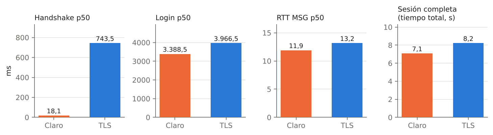
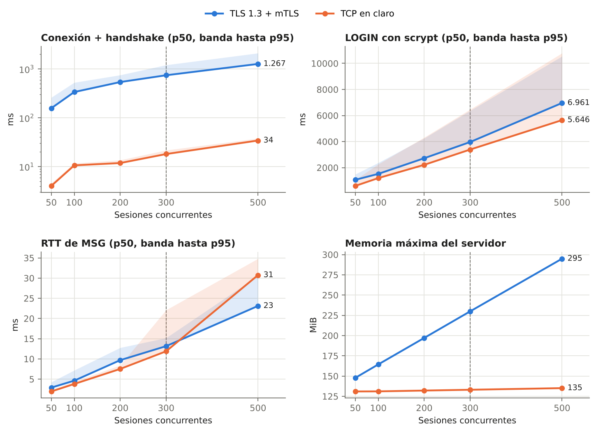
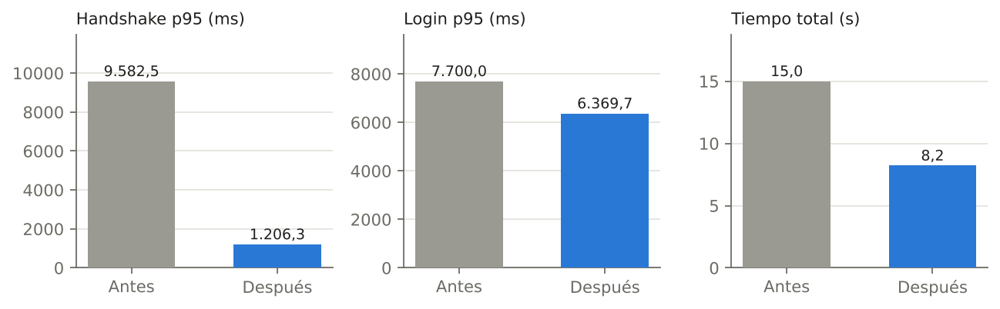

# PAI-2 BYODSEC — Secciones del Rol C (Rendimiento, Auditoría, Extra y Completitud)

> Grupo 20 · Security Team. Estas secciones se integran en el PDF final (apartados 4–6).
> Todas las cifras proceden de `evidence/` y son reproducibles con los comandos de `docs/README_rolc.md`.
> Máquina de prueba: 2 vCPU, Python 3.13.16, OpenSSL 3.0.13; todos los servicios en la misma máquina.

---

## 4. Rendimiento y escalabilidad (Obj.3, RS3)

Para medir el coste real de la seguridad se ejecuta el mismo flujo de aplicación
(conexión → `LOGIN` → 20 × `MSG` → `LOGOUT`) sobre dos canales idénticos salvo en
el transporte: el gateway **TLS 1.3 + mTLS** (puerto 9443) y un servidor de
**referencia en claro** (`bench/plain_server.py`) que reutiliza exactamente la misma
lógica sobre TCP sin cifrar. La diferencia entre ambos es, por tanto, solo TLS.

El generador de carga (`bench/load_test.py`) abre las N sesiones y las retiene con
una **barrera**: nadie envía mensajes hasta que las N están autenticadas a la vez,
de modo que se mide concurrencia real y no conexiones escalonadas.

### 4.1 Resultado principal: 300 sesiones concurrentes

El sistema sostiene **300/300 sesiones simultáneas sin fallos** sobre el túnel,
negociando en todas ellas `TLS_AES_256_GCM_SHA384`.

| Métrica (300 sesiones) | TCP en claro | TLS 1.3 + mTLS | Sobrecoste |
|---|---|---|---|
| Sesiones correctas | 300 / 300 | 300 / 300 | — |
| Conexión + handshake (p50) | 18 ms | 743 ms | ×41 |
| `LOGIN` con scrypt (p50) | 3 389 ms | 3 967 ms | +17 % |
| RTT por `MSG` (p50) | 11,9 ms | 13,2 ms | +11 % |
| RTT por `MSG` (p95) | — | 15,2 ms | — |
| Throughput de mensajes | — | ≈ 22 400 msg/s | — |
| Memoria máx. del servidor | 133 MiB | 230 MiB | +73 % |

Lectura: el coste de TLS se concentra **en el handshake** (criptografía asimétrica
P-384 del mTLS), no en el tráfico posterior. Una vez establecido el canal, cada
mensaje cuesta solo un 11 % más que en claro, porque el cifrado simétrico AEAD es
barato. El `LOGIN` tarda mucho en ambos casos **por diseño**: `scrypt` es
deliberadamente costoso (≈ 42 ms, 16 MiB por derivación) para frenar el crackeo de
contraseñas; esa latencia la aporta la defensa de credenciales, no TLS.

### 4.2 Escalado 50 → 500

| Sesiones | Correctas (TLS) | Handshake p50 | RTT p50 | Memoria máx. |
|---|---|---|---|---|
| 50 | 50/50 | 157 ms | 2,9 ms | 148 MiB |
| 100 | 100/100 | 337 ms | 4,6 ms | 164 MiB |
| 200 | 200/200 | 539 ms | 9,7 ms | 197 MiB |
| 300 | 300/300 | 743 ms | 13,2 ms | 230 MiB |
| 500 | 500/500 | 1 267 ms | 23,1 ms | 295 MiB |

El servidor `asyncio` monohilo escala linealmente hasta 500 sesiones (el doble del
objetivo) sin pérdidas. La memoria crece de forma suave y moderada (≈ 0,3 MiB por
sesión). El tiempo de handshake aumenta porque los 2 vCPU serializan las operaciones
P-384, no por saturación de red.

### 4.3 Optimización aplicada

La primera versión ejecutaba `authenticate_user()` (con `scrypt`) **dentro del bucle
de eventos** de `asyncio`. Al llegar 300 logins a la vez, cada derivación bloqueaba
el bucle y retrasaba todos los handshakes pendientes: el p95 de conexión llegaba a
≈ 9,6 s. Moviendo la verificación a un hilo con `asyncio.to_thread()` el bucle sigue
aceptando conexiones mientras scrypt trabaja, y el tiempo total de la ronda de 300
sesiones baja de 15,0 s a 8,2 s.

---

## 5. Auditoría de tráfico y confidencialidad del canal (Obj.4, RS4)

### 5.1 El túnel oculta lo que el canal en claro expone

Se capturan con `tcpdump` dos `LOGIN` idénticos, uno por cada canal, y se busca la
contraseña en texto plano dentro de cada `.pcap`:

| Captura | Canal | ¿Contraseña visible en el `.pcap`? |
|---|---|---|
| `evidence/pcap/01_plain_login.pcap` | TCP en claro | **Sí** — `usuario` y `password` legibles |
| `evidence/pcap/02_tunnel_login.pcap` | TLS 1.3 + mTLS | **No** — solo registros cifrados |

En la captura del túnel, Wireshark solo muestra el handshake TLS 1.3
(`supported_versions = 0x0304`, ServerHello con suite `0x1302` =
`TLS_AES_256_GCM_SHA384`) y, a partir de ahí, `Application Data` opaco. Las
credenciales y los mensajes son ininteligibles para un observador en la red.

### 5.2 Integridad del canal

TLS 1.3 solo admite cifrados **AEAD** (`AES-256-GCM` y `ChaCha20-Poly1305`). Cada
registro lleva una etiqueta de autenticación: si un atacante en el camino alterase
un solo bit del texto cifrado, la verificación de la etiqueta fallaría en el receptor
y el registro se descartaría cerrando la conexión. No es posible modificar el
contenido sin ser detectado ni reutilizar fragmentos de otra sesión (cada una deriva
claves distintas). Esta integridad es intrínseca al canal y complementa la cadena
HMAC del registro de auditoría (Rol A), que protege el log *en reposo*.

### 5.3 Registro de auditoría de los ataques

Cada intento de acceso ilegítimo queda reflejado en `evidence/logs/audit.jsonl`.
Un ejemplo de la batería de ataques (313 registros, cadena HMAC verificada con
`verify_audit.py`):

| Evento | Veces | Origen |
|---|---|---|
| `ENROLL` | 300 | Precarga de usuarios (RF5) |
| `LOGIN_OK` / `LOGOUT` / `DISCONNECT` | 1 / 1 / 1 | Sesión legítima de referencia |
| `TLS_FAIL` | 4 | Sin certificado, CA ajena, TLS 1.2, certificado revocado |
| `LOGIN_FAIL` → `LOCKED` | 4 → 2 | Fuerza bruta de contraseña (RF2) |

Para que estos rechazos quedaran registrados hubo que hacer el handshake TLS de forma
explícita en el gateway (`tls_guard`): con `asyncio.start_server(ssl=...)` los
handshakes fallidos se descartaban en silencio y no dejaban traza.

---

## 6. Grado de completitud y batería de ataques (Obj.5, extra +10%)

### 6.1 Ataques contra el túnel

Cada ataque es un **intento de acceso que debe ser rechazado**. Resultado:
**7 de 7 rechazados** (`evidence/logs/attacks_summary.json`).

| # | Ataque | Resultado | Evidencia |
|---|---|---|---|
| 1 | Sniffing pasivo de credenciales | Ilegible en el túnel | `01_plain_login.pcap` vs `02_tunnel_login.pcap` |
| 2 | Cliente **sin certificado** | Handshake abortado por el servidor | `02_no_cert.pcap`, `TLS_FAIL` |
| 3 | Cliente con cert de **CA falsa** | Rechazado (cadena no confiable) | `03_other_ca.pcap`, `TLS_FAIL` |
| 4 | **Suplantación de servidor** (CA falsa) | El cliente aborta; no envía credenciales | `07_rogue_server`, demo |
| 5 | **Downgrade a TLS 1.2** | Rechazado (min = max = TLS 1.3) | `04_tls12_downgrade.pcap`, `TLS_FAIL` |
| 6 | **Suite débil** `TLS_AES_128_GCM_SHA256` | Rechazado (`NO_SHARED_CIPHER`) | `05_weak_suite_128.pcap` |
| 7 | Certificado **revocado** | Rechazado por la CRL | `08_revoked.pcap`, `TLS_FAIL` |
| 8 | **Fuerza bruta** de contraseña | Cuenta bloqueada a los 5 intentos | `06_brute_force.pcap`, `LOCKED` |

La demo de suplantación de servidor (`attacks/rogue_server.py`) levanta un gateway
falso con un certificado `localhost` de una CA del atacante; el cliente legítimo,
que solo confía en la CA corporativa, **aborta el handshake antes de enviar usuario
y contraseña**, de modo que el servidor falso no captura ningún secreto. La suite
débil se comprueba con `openssl s_client` porque la versión de Python del entorno no
permite fijar la suite TLS 1.3 del lado cliente.

Correcciones de seguridad introducidas al integrar esta batería:
- **Política de suites TLS 1.3 (RS2).** `openssl.cnf` se reescribió con la sección
  `ssl_conf`/`system_default` correcta y `gateway.py` exporta `OPENSSL_CONF` **antes**
  de importar `ssl`; sin esto el servidor aceptaba `TLS_AES_128_GCM_SHA256`. Se añadió
  `enforce_tls13_policy()`, que **falla al arrancar** si OpenSSL ofreciera otra suite.
- **Recarga de CRL.** El contexto mTLS se reconstruye al cambiar `crl.pem`
  (`ReloadingContext`); antes, un certificado revocado seguía entrando hasta reiniciar.

### 6.2 Matriz de trazabilidad (parte del Rol C)

| Requisito | Módulo | Prueba | Evidencia |
|---|---|---|---|
| Obj.3 · 300 sesiones | `bench/load_test.py` | `load_test --clients 300` | `summary_tls.json` (300/300) |
| Obj.3 · comparativa | `bench/plain_server.py`, `bench/plot.py` | escalado 50–500 | `escalado_tls_vs_claro.png` |
| Obj.4 · auditoría de tráfico | `docker/capture.sh`, `attacks/capture_plain_vs_tunnel.py` | capturas | `evidence/pcap/*` |
| Obj.5 · MitM / suplantación (extra) | `attacks/*` | `run_attacks`, `test_attacks.py` | `attacks_summary.json` (7/7) |
| RS2 · TLS 1.3 + suites AEAD | `server/tls.py`, `server/openssl.cnf` | `probe_tls12`, `probe_weak_suite` | `04_*`, `05_*.pcap` |
| RS3 · 300 sesiones + comparativa | `bench/*` | `load_test` ambos modos | `summary_*.json`, gráficas |
| RS4 · `.pcap` + registros | `docker/capture.sh`, auditoría | captura + `verify_audit` | `evidence/pcap/*`, `audit.jsonl` |

### 6.3 Estado global del proyecto

- **Pruebas**: 16/16 en verde (`pytest`), incluidas las 5 nuevas de `test_attacks.py`.
- **Rendimiento**: 300 sesiones sostenidas; escalado comprobado hasta 500.
- **Ataques**: 7/7 rechazados, cada uno con captura y/o traza de auditoría.
- **Despliegue**: `docker compose` reproducible (gateway, sniffer, bench, atacante).
